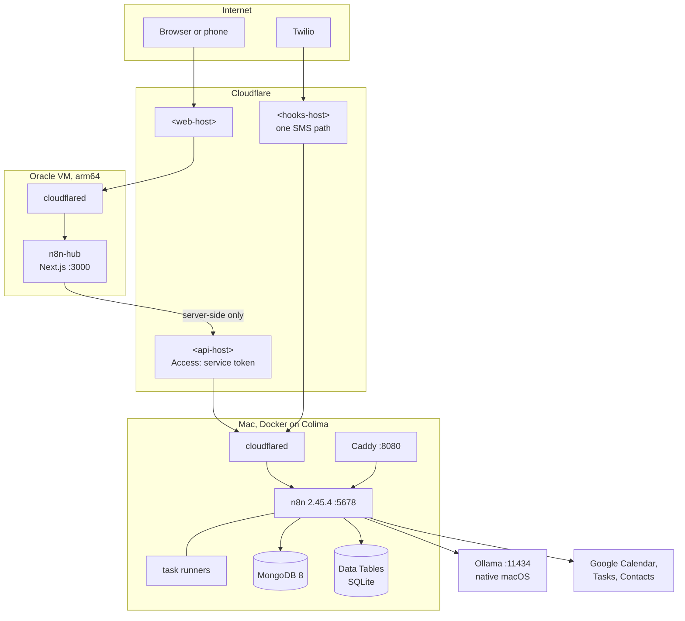

Course Hub keeps everything that computes or stores data on one Mac. The Oracle VM only serves pages. Cloudflare connects the two, and Course Hub opens no inbound port on either machine.

## The big picture

## What runs where

**The Mac** runs n8n, its task runners, MongoDB, Caddy and cloudflared as one Docker Compose project, `course-hub`, on Colima. Ollama runs natively, because it needs the Metal GPU. launchd agents start Colima at login, check health every 5 minutes, write a memory probe every minute and keep the Mac awake on power.

**The Oracle VM** runs the web app container, plus a small edge stack: a cloudflared connector and a Caddy that serves an unrelated site. n8n used to run here, and moved to the Mac on 2026-10-31.

**Cloudflare** carries two tunnels. The VM's tunnel publishes the web app. The Mac's tunnel publishes two hostnames, each restricted to an allow-list of paths: the API (protected by Cloudflare Access) and the single Twilio webhook.

**Google** holds the calendars and task lists that you see on your phone. Course Hub writes only to the **Study Blocks** calendar and the **Coursework** task list.

## A request, end to end

When you open the home screen of the web app:

1. The browser asks `<web-host>` for `/`. Cloudflare passes it through the VM's tunnel to `n8n-hub:3000`.
2. Next.js sends the prerendered shell at once, then calls `getOverview()` on the server.
3. `hubRequest()` calls `https://<api-host>/webhook/hub/api/overview` with the service token headers.
4. Cloudflare Access checks the token, and the Mac's tunnel forwards the request to `n8n:5678`.
5. The Website + API workflow reads the Data Tables and returns JSON.
6. zod validates the JSON and drops fields the UI doesn't need. The page streams in.

If step 3 fails because the Mac is asleep, Cloudflare answers `530`, and the app shows the last good answer with its time.

## Why it's built this way

- **Data on the Mac.** The course files, the local AI and the personal data stay on hardware you own. The VM never stores course data.
- **Server-side calls only.** The browser can't reach the API. The service token never leaves the VM.
- **No inbound ports for Course Hub.** Both machines connect out to Cloudflare. On the VM, the container listens on port `3000` inside the Docker network, where cloudflared reaches it as `n8n-hub:3000`. It's also published on the VM's loopback as `127.0.0.1:3010`, for smoke tests only.
- **Two stores.** Data Tables are fast and local, and every workflow reads them. MongoDB is a mirror with schema validators and indexes, for queries and as a second copy.

Trade-offs are in [Design decisions](/course-hub-docs/explanation/design-decisions/).

## Next steps

- [Security model](/course-hub-docs/explanation/security-model/)
- [Configuration](/course-hub-docs/reference/configuration/)
