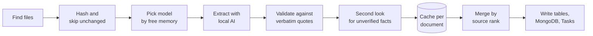

The ingest workflow turns a folder of course documents into structured facts: courses, contacts, assessments with weights and dates, and weekly topics. Its main rule is simple: **a weight or date is kept only if the document says it in words that can be found.**

## The pipeline

## 1. Find files

Each course has a folder in `<courses-folder>/<CODE>/`. Files are ranked by where they sit:

| Rank | Location | Role |
|---|---|---|
| 1 | `Syllabus/*` | The course outline |
| 2 | `Admin/*.pdf` | The official course page |
| 3 | `Weeks/Week 01*` or `Lectures/Week 01*`, organizational files only | First-week intro documents |
| 4 | `Transcripts/Week 01*.md`, organizational files only | Gap-fill only |

Folders starting with `_`, hidden files, `~$` lock files, `_INDEX.md` and `.textClipping` files are skipped.

## 2. Skip what hasn't changed

Every file is hashed with SHA-256 and compared with `ch_ingest_registry`. A file is read again only if:

- its hash changed, or a `force` or `course` scan asks for it;
- it was read by the smaller fallback model and the better one now fits in memory;
- it was read under an older `RULES_VERSION` (currently 2). Bump this number whenever prompts or validation rules change, so every file gets one fresh read.

## 3. Pick a model that fits

The local AI must not push the Mac past `ai_memory_cap_pct` (80%) of its 48 GB. The workflow reads the memory probe, which must be at most 5 minutes old, and picks the best model that fits:

| Model | Adds | Settings |
|---|---|---|
| `gpt-oss:20b` | about 14.6 GB | `think: "low"`, 16k context, 6,000 output tokens |
| `qwen3.5:9b` | about 9.7 GB | `think: false`, 12k context, 3,000 output tokens |

If neither fits, the run is deferred, and the watchdog retries it at most every 30 minutes.

:::note[Why gpt-oss has a bigger budget]
gpt-oss always reasons, even with `think: false`, and its reasoning counts against the output budget. With 3,000 tokens it spent everything on reasoning and returned nothing. With `think: "low"` and 6,000 tokens, it returns complete JSON in about 19 seconds.
:::

## 4. Validate every number against the text

The model's output is a claim, not a fact. Each claim is checked against the excerpt the model actually read, with matching that tolerates punctuation and whitespace:

- **Grounding.** An assessment whose title and quote appear nowhere in the text is dropped.
- **Weight on its own line.** A weight must sit on a line that names the item. A stray "13%" elsewhere proves nothing. If the item's line has exactly one number and the model's number differs, the line wins and the item is flagged for review.
- **Group sums.** A group's parts must add up to the group's weight. Missing numbered parts, such as P5 and P6, are recovered from their own lines.
- **Safety net.** Every "item NN%" line that matches assessment keywords is kept as a candidate. If a course's total falls short of 100%, those candidates fill the gap.

Anything still unproven goes to a **second look**: a small model is shown only the short excerpt and asked whether it supports the claim. Facts that fail are kept with `needs_review` set, and they appear in **Check my facts**.

## 5. Cache per document

Results are stored per document and task in `ch_doc_facts`. A course is always rebuilt from **all** its cached documents, not only the ones that changed. A failed read never replaces a document's last good result.

## 6. Merge by source rank

When two sources disagree, the higher rank wins:

1. **Overrides**: your confirmations and fixes (rank 0)
2. **Registrar timetable**: class meetings and final-exam slots
3. **Syllabus**: a course *schedule* document wins over the outline for **dates**
4. **Official course page**
5. **First-week intro documents**
6. **Week-1 transcripts**: gap-fill only

Within a rank, a syllabus beats a schedule, then admin, intro and transcript documents, and a `.md` file wins a tie. Assessment ids are reused across reads by fuzzy title matching, so a Google Task and its done status survive a re-read.

## Re-scan modes

| Mode | When to use it |
|---|---|
| `{}` | Normal: changed files only |
| `force` | You suspect the cache is wrong |
| `course` | One course's files changed or need a fresh read |
| `remerge` | You changed the merge logic in `build.py`. No AI, seconds. |
| `revalidate` | You changed validation rules. No AI. |

See [Re-scan course files](/course-hub-docs/how-to/rescan-course-files/).

## Limitations

- Extraction quality depends on the local model. The validator stops invented numbers, but it can't find a weight the document never states.
- Only week-1 organizational files are read from the weekly folders. Later announcements need an override.
- A scan waits whenever memory is tight, so facts can lag behind a file change by up to 30 minutes, or longer while other apps hold memory.

## Next steps

- [Confirm or fix a fact](/course-hub-docs/how-to/fix-a-fact/)
- [Data model](/course-hub-docs/reference/data-model/)
