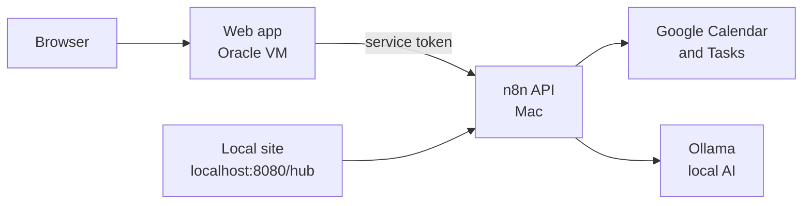

import { Card, CardGrid, LinkCard } from '@astrojs/starlight/components';

Course Hub has two parts. The **backend** runs n8n, local AI and the databases on one Mac. The **web app** is a small Next.js site on an Oracle Cloud VM that shows the same data to your phone or any browser.

## Find what you need

<CardGrid>
  <Card title="Learn it" icon="open-book">
    New here? [Plan and wrap up your first day](/course-hub-docs/tutorials/plan-your-first-day/) walks you through the web app in about 10 minutes.
  </Card>
  <Card title="Do a task" icon="rocket">
    [How-to guides](/course-hub-docs/how-to/deploy-the-web-app/) cover deploying, previewing a plan, fixing a fact and changing settings.
  </Card>
  <Card title="Look it up" icon="information">
    [Reference](/course-hub-docs/reference/hub-api/) lists every endpoint, workflow, table, setting, command and dependency.
  </Card>
  <Card title="Understand it" icon="puzzle">
    [Explanation](/course-hub-docs/explanation/architecture/) covers why it's built this way: architecture, ingest rules, the planner and security.
  </Card>
</CardGrid>

## When something breaks

<LinkCard title="Runbook index" description="Symptoms first: stale data, a failed deploy, a plan that wrote nothing, an AI scan stuck waiting." href="/course-hub-docs/operations/" />
